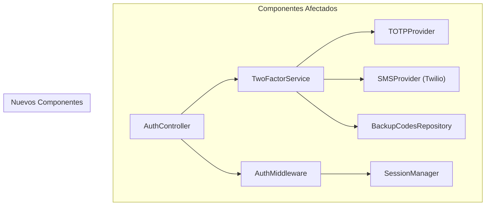
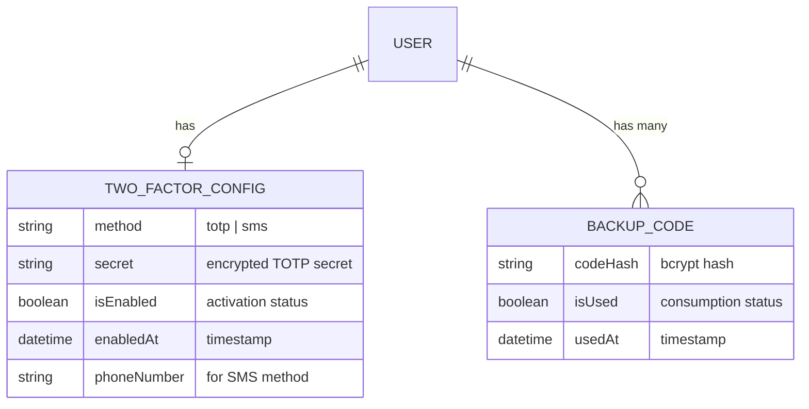
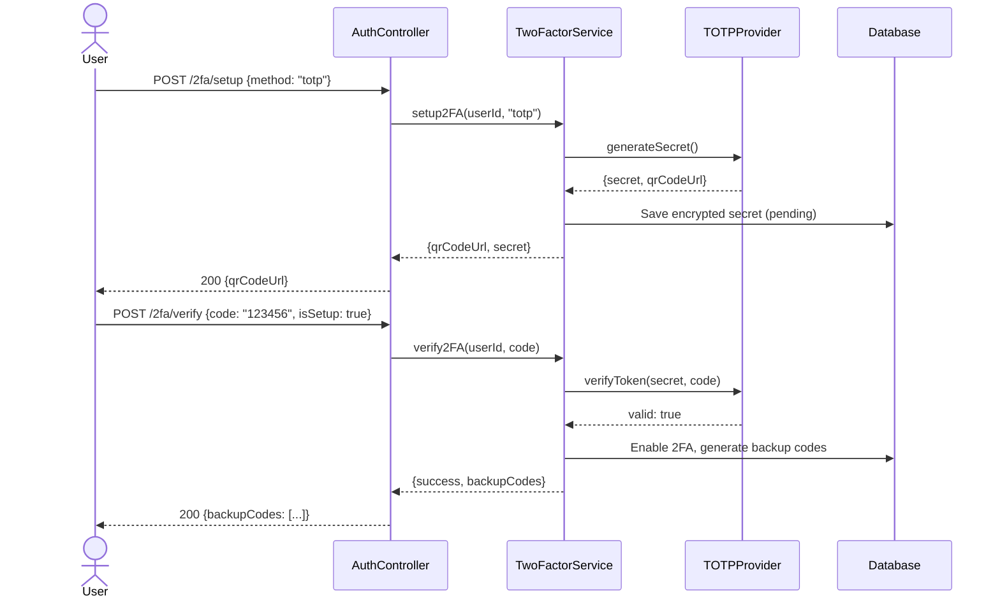

# Diseño Técnico: US98765 — Implementar Autenticación de Dos Factores (2FA)

> **Rally ID:** US98765
> **Basado en:** `.docs/requerimientos.md`
> **Stack detectado:** nodejs (TypeScript, Express, Jest)
> **Fecha de generación:** 2024-12-15

---

## Diagrama de Arquitectura



## Archivos a Modificar

| Archivo | Tipo de Cambio | Justificación |
|:---|:---|:---|
| `src/controllers/auth.controller.ts` | Modificar | Añadir endpoints de configuración y verificación 2FA |
| `src/middleware/auth.middleware.ts` | Modificar | Añadir verificación 2FA al flujo de autenticación |
| `src/routes/auth.routes.ts` | Modificar | Registrar nuevas rutas 2FA |
| `src/models/user.model.ts` | Modificar | Añadir campos 2FA al modelo de usuario |

## Archivos Nuevos a Crear

### `src/services/two-factor.service.ts`
- **Responsabilidad:** Orquestar la lógica de 2FA (setup, verify, disable)
- **Interfaces:** `setup2FA()`, `verify2FA()`, `disable2FA()`, `generateBackupCodes()`
- **Dependencias:** `TOTPProvider`, `SMSProvider`, `BackupCodesRepository`

### `src/providers/totp.provider.ts`
- **Responsabilidad:** Generar y validar códigos TOTP según RFC 6238
- **Interfaces:** `generateSecret()`, `generateQRCode()`, `verifyToken()`
- **Dependencias:** `otplib`, `qrcode`

### `src/providers/sms.provider.ts`
- **Responsabilidad:** Enviar códigos de verificación por SMS via Twilio
- **Interfaces:** `sendVerificationCode()`, `verifyCode()`
- **Dependencias:** `twilio` SDK

### `src/repositories/backup-codes.repository.ts`
- **Responsabilidad:** CRUD de códigos de respaldo cifrados
- **Interfaces:** `generate()`, `validate()`, `invalidate()`
- **Dependencias:** `crypto`, `UserModel`

### Tests
- `src/services/__tests__/two-factor.service.test.ts`
- `src/providers/__tests__/totp.provider.test.ts`
- `src/providers/__tests__/sms.provider.test.ts`
- `src/controllers/__tests__/auth.controller.2fa.test.ts`

## Modelo de Datos



## Contratos de Interfaz

```typescript
// POST /api/auth/2fa/setup
interface Setup2FARequest {
  method: 'totp' | 'sms';
  phoneNumber?: string; // Required if method === 'sms'
}
interface Setup2FAResponse {
  qrCodeUrl?: string;   // Present if method === 'totp'
  secret?: string;       // Present if method === 'totp'
  message: string;
}

// POST /api/auth/2fa/verify
interface Verify2FARequest {
  code: string;          // 6-digit TOTP or SMS code
  isSetup?: boolean;     // true during initial setup verification
}
interface Verify2FAResponse {
  success: boolean;
  backupCodes?: string[]; // Only returned on initial setup
  token?: string;         // JWT token on successful login verification
}

// DELETE /api/auth/2fa/disable
// Requires current password confirmation
interface Disable2FARequest {
  password: string;
}
```

## Decisiones de Diseño

| Decisión | Alternativas | Justificación |
|:---|:---|:---|
| TOTP con `otplib` | Implementación manual RFC 6238 | Librería madura, bien mantenida, reduce riesgo de bugs criptográficos |
| Twilio para SMS | Vonage, AWS SNS | Ya contratado por la empresa, SDK robusto para Node.js |
| Códigos de respaldo con bcrypt | AES-256, plaintext | Hash unidireccional más seguro; el usuario ve los códigos solo una vez |
| 10 códigos de respaldo | 5, 15, 20 | Balance entre seguridad y usabilidad (estándar de la industria) |

## Estrategia de Testing

| Tipo de Test | Archivo | Cobertura |
|:---|:---|:---|
| Unitario | `two-factor.service.test.ts` | Setup flow, verify flow, disable flow, error cases |
| Unitario | `totp.provider.test.ts` | Secret generation, QR generation, token validation |
| Unitario | `sms.provider.test.ts` | SMS sending, code verification (mocked Twilio) |
| Integración | `auth.controller.2fa.test.ts` | Full HTTP flow: setup → verify → login with 2FA |
| Edge Case | (incluidos en unitarios) | Expired codes, max retries, concurrent requests |

## Consideraciones de Seguridad

- **Secretos TOTP**: Cifrados con AES-256-GCM antes de almacenar en DB
- **Códigos de respaldo**: Hasheados con bcrypt (salt rounds: 12)
- **Rate limiting**: Máximo 5 intentos de verificación por ventana de 15 minutos
- **Audit logging**: Todos los eventos 2FA registrados con timestamp, IP, user-agent
- **HTTPS only**: Endpoints 2FA rechazan requests no-TLS

## Diagrama de Secuencia (Flujo Principal)



## Plan de Implementación

| Orden | Tarea | Archivo(s) | Estimación |
|:------|:------|:-----------|:-----------|
| 1 | Crear TOTP Provider | `totp.provider.ts` + tests | 2h |
| 2 | Crear SMS Provider | `sms.provider.ts` + tests | 2h |
| 3 | Crear Backup Codes Repository | `backup-codes.repository.ts` | 1h |
| 4 | Crear Two Factor Service | `two-factor.service.ts` + tests | 3h |
| 5 | Modificar User Model | `user.model.ts` | 30min |
| 6 | Modificar Auth Controller | `auth.controller.ts` + tests | 2h |
| 7 | Modificar Auth Middleware | `auth.middleware.ts` | 1h |
| 8 | Actualizar rutas | `auth.routes.ts` | 30min |

## Riesgos Técnicos

| Riesgo | Probabilidad | Impacto | Mitigación |
|:-------|:-------------|:--------|:-----------|
| Twilio SMS downtime | Baja | Alto | Fallback a método TOTP con mensaje informativo |
| Clock drift en TOTP | Media | Medio | Aceptar ventana de ±1 step (90 segundos totales) |
| Brute force en códigos 2FA | Media | Alto | Rate limiting + bloqueo temporal tras 5 intentos |
