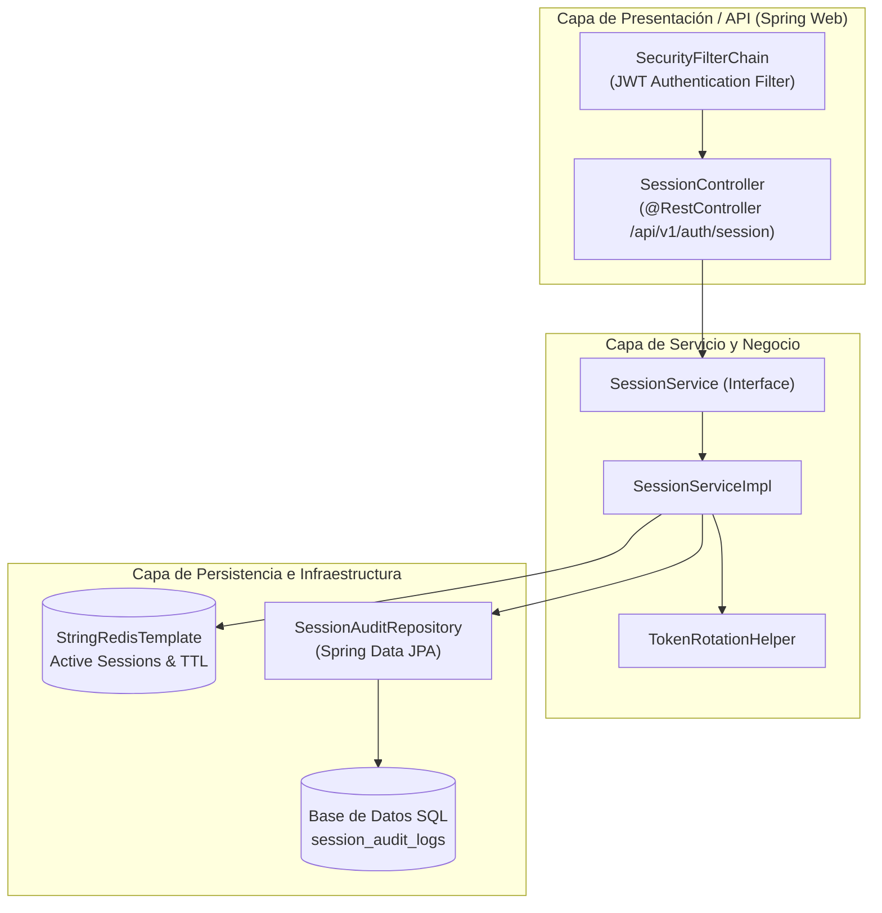
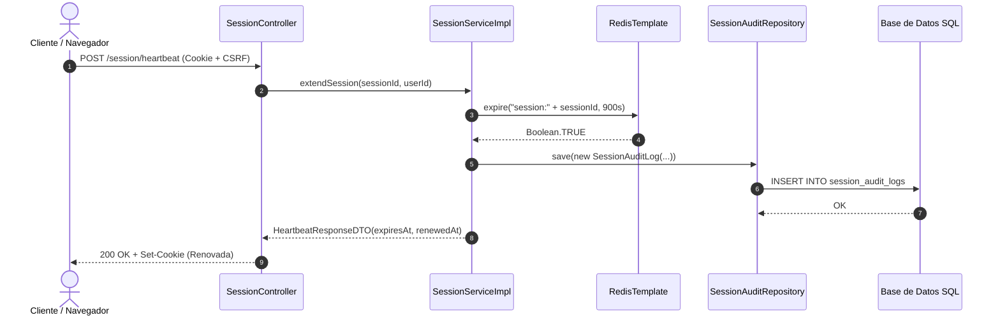

# Documento de Diseño Técnico: US10293 — Renovación de Sesión por Heartbeat (Java)

> **Identificador Rally:** `US10293`  
> **Basado en:** `.docs/requerimientos_java.md` (US10293)  
> **Stack Detectado:** `java (Java 21, Spring Boot 3.3, Spring Data JPA / SQL, Spring Data Redis, JUnit 5, Maven)`  
> **Fecha de Generación:** 2026-10-24  
> **Arquitecto / Agente:** Copilot SDLC Automation Agent  

---

## 1. Diagrama de Arquitectura de Componentes



---

## 2. Inventario de Archivos Impactados

| Ruta de Archivo | Tipo de Acción | Justificación Técnica (Vínculo EARS) |
| :--- | :--- | :--- |
| `src/main/java/com/bank/auth/dto/HeartbeatResponseDTO.java` | **Nuevo** | Record DTO inmutable para respuesta JSON con validación (REQ-UBI-01). |
| `src/main/java/com/bank/auth/dto/RevokeSessionRequestDTO.java` | **Nuevo** | DTO con validaciones `@NotBlank` para solicitudes de revocación (REQ-UBI-01). |
| `src/main/java/com/bank/auth/entity/SessionAuditLog.java` | **Nuevo** | Entidad JPA mapeada a la tabla SQL `session_audit_logs` (REQ-EVT-02, REQ-UBI-02). |
| `src/main/java/com/bank/auth/repository/SessionAuditRepository.java` | **Nuevo** | Interfaz `JpaRepository` para operaciones SQL transaccionales (REQ-EVT-02). |
| `src/main/java/com/bank/auth/service/SessionService.java` | **Nuevo** | Interfaz desacoplada de reglas de negocio de sesión (REQ-EVT-01, REQ-STA-02). |
| `src/main/java/com/bank/auth/service/impl/SessionServiceImpl.java` | **Nuevo** | Implementación transaccional (`@Transactional`) con Redis y JPA (REQ-EVT-01, REQ-STA-02). |
| `src/main/java/com/bank/auth/controller/SessionController.java` | **Modificar** | Exposición de `@PostMapping("/heartbeat")` y `@PostMapping("/revoke")` (REQ-EVT-01, REQ-NEG-01). |
| `src/test/java/com/bank/auth/controller/SessionControllerTest.java` | **Nuevo** | Pruebas de integración web con `@WebMvcTest` y `MockMvc` (REQ-EVT-01, REQ-NEG-01). |
| `src/test/java/com/bank/auth/service/SessionServiceTest.java` | **Nuevo** | Pruebas unitarias con JUnit 5 y mocks de Mockito (`RedisTemplate`, `SessionAuditRepository`). |

---

## 3. Especificación de Nuevos Módulos y Componentes

### 3.1 DTOs Inmutables (Java Records)
```java
package com.bank.auth.dto;

import java.time.Instant;

public record HeartbeatResponseDTO(
    boolean success,
    Instant sessionExpiresAt,
    Instant renewedAt
) {}
```

### 3.2 Servicio de Sesión
```java
package com.bank.auth.service;

import com.bank.auth.dto.HeartbeatResponseDTO;

public interface SessionService {
    // Rally: US10293 — Requisito EARS: REQ-EVT-01
    HeartbeatResponseDTO extendSession(String sessionId, String userId);

    // Rally: US10293 — Requisito EARS: REQ-EVT-02
    void revokeSession(String sessionId, String userId, String reason);
}
```

---

## 4. Modelo de Datos y Esquema SQL

```sql
-- DDL para PostgreSQL / MySQL:
CREATE TABLE IF NOT EXISTS session_audit_logs (
    id VARCHAR(36) PRIMARY KEY,
    user_id VARCHAR(50) NOT NULL,
    session_id VARCHAR(64) NOT NULL,
    event_type VARCHAR(30) NOT NULL,
    ip_address VARCHAR(45),
    correlation_id VARCHAR(36) NOT NULL,
    created_at TIMESTAMP WITH TIME ZONE DEFAULT CURRENT_TIMESTAMP
);

CREATE INDEX IF NOT EXISTS idx_session_audit_user_id ON session_audit_logs(user_id);
```

### Mapeo Entidad JPA
```java
package com.bank.auth.entity;

import jakarta.persistence.*;
import java.time.Instant;
import java.util.UUID;

@Entity
@Table(name = "session_audit_logs")
public class SessionAuditLog {
    @Id
    @Column(length = 36)
    private String id = UUID.randomUUID().toString();

    @Column(name = "user_id", nullable = false, length = 50)
    private String userId;

    @Column(name = "session_id", nullable = false, length = 64)
    private String sessionId;

    @Column(name = "event_type", nullable = false, length = 30)
    private String eventType;

    @Column(name = "correlation_id", nullable = false, length = 36)
    private String correlationId;

    @Column(name = "created_at", nullable = false)
    private Instant createdAt = Instant.now();

    // Constructores, Getters y Setters
}
```

---

## 5. Contratos de Interfaz (Spring MVC)

### 5.1 Endpoint Heartbeat
```http
POST /api/v1/auth/session/heartbeat HTTP/1.1
Host: api.banking.internal
Cookie: session_token=s_82a7f1...
X-CSRF-Token: d41b8a...

HTTP/1.1 200 OK
Content-Type: application/json
Set-Cookie: session_token=s_99f2c0...; HttpOnly; Secure; SameSite=Strict; Max-Age=900; Path=/

{
  "success": true,
  "sessionExpiresAt": "2026-10-24T20:25:00Z",
  "renewedAt": "2026-10-24T20:10:00Z"
}
```

---

## 6. Registro de Decisiones de Arquitectura (ADR)

| Decisión | Opciones Consideradas | Opción Elegida | Justificación Técnica |
| :--- | :--- | :--- | :--- |
| **Persistencia Híbrida** | A) Sesiones en tabla SQL única<br>B) Redis para estado volátil + SQL para auditoría | **Opción B** | Rendimiento en microsegundos para chequeos frecuentes en Redis; ACID e inmutabilidad en SQL. |
| **Cliente Redis en Spring** | A) Jedis<br>B) Lettuce | **Opción B** | Basado en Netty, no bloqueante y thread-safe para alta concurrencia. |

---

## 7. Estrategia de Testing (JUnit 5 & MockMvc)

| Nivel de Test | Archivo | Criterio EARS Validado |
| :--- | :--- | :--- |
| **Unitaria Servicio** | `SessionServiceTest.java` | `REQ-EVT-01`: Invocación `redisTemplate.expire(..., 900, SECONDS)` y guardado en `sessionAuditRepository`. |
| **Unitaria Negativa** | `SessionServiceTest.java` | `REQ-NEG-01`: Lanzamiento de `SessionExpiredException` si no existe la clave en Redis. |
| **Integración MVC** | `SessionControllerTest.java` | `REQ-EVT-01`: Llamada HTTP con `MockMvc` retornando estado 200 y cabecera `Set-Cookie`. |
| **Integración MVC** | `SessionControllerTest.java` | `REQ-EVT-02`: Solicitud de revocación retornando 200 OK y eliminando la cookie de sesión. |

---

## 8. Consideraciones de Seguridad (OWASP Top 10)

- **A02:2021 — Cryptographic Failures:** Cookies configuradas mediante `ResponseCookie.from(...)` con flags `httpOnly(true)` y `secure(true)`.
- **A03:2021 — Injection:** Spring Data JPA utiliza consultas preparadas (Prepared Statements) bajo Hibernate; cero concatenación SQL.
- **A07:2021 — Identification Failures:** Sesiones destruidas inmediatamente en Redis al revocar o expirar.

---

## 9. Diagrama de Secuencia del Flujo de Heartbeat en Spring Boot


