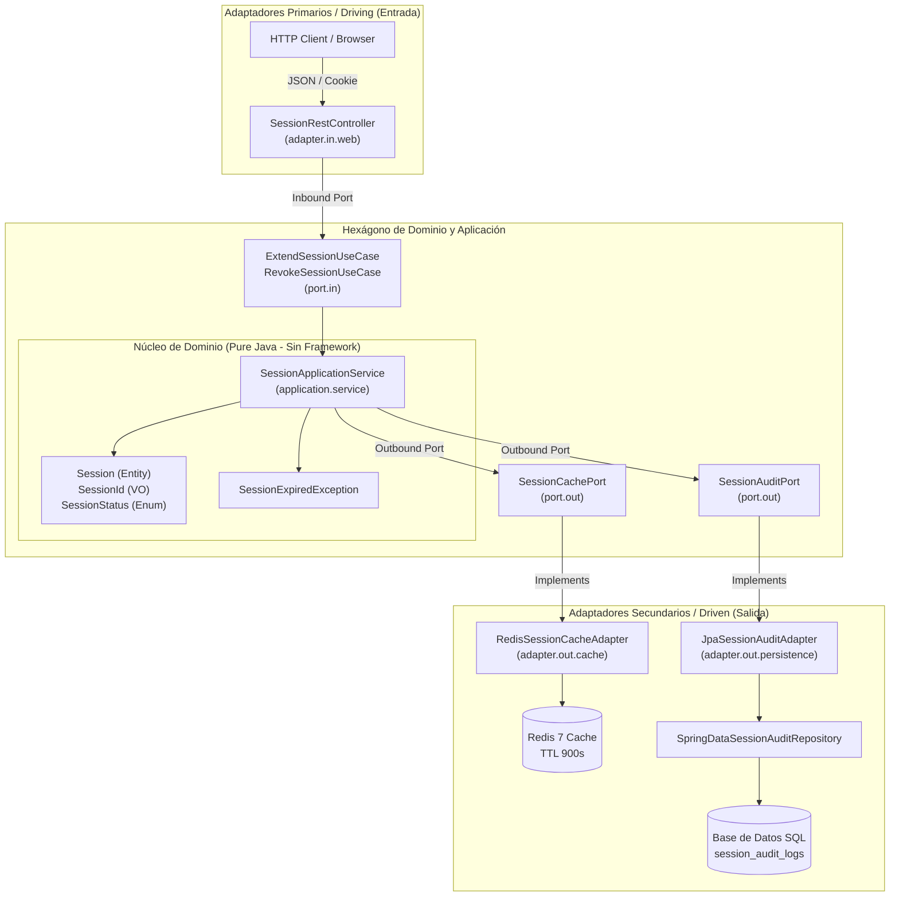
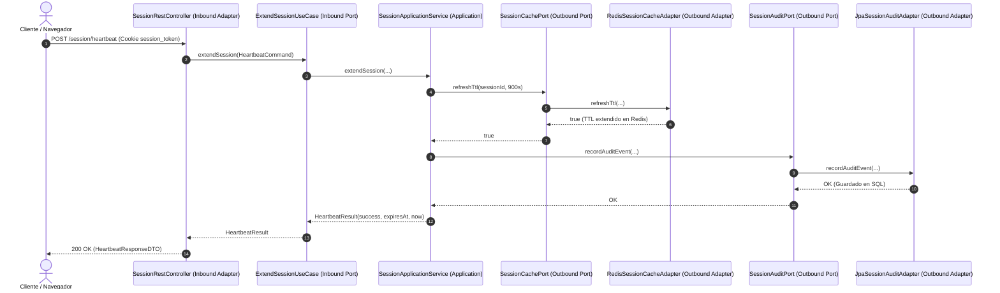

# Documento de Diseño Técnico: US10293 — Renovación de Sesión por Heartbeat (Java — Arquitectura Hexagonal)

> **Identificador Rally:** `US10293`  
> **Basado en:** `.docs/requerimientos_java.md` (US10293)  
> **Stack Detectado:** `java (Java 21, Spring Boot 3.3, Spring Data JPA / SQL, Spring Data Redis, JUnit 5, Maven)`  
> **Patrón Arquitectónico:** **Arquitectura Hexagonal (Ports and Adapters)**  
> **Fecha de Generación:** 2026-10-24  
> **Arquitecto / Agente:** Copilot SDLC Automation Agent  

---

## 1. Diagrama de Arquitectura Hexagonal (Puertos y Adaptadores)



---

## 2. Inventario de Archivos y Estructura Hexagonal

```text
src/main/java/com/bank/auth/
├── domain/                                        <-- Núcleo de Dominio (Sin dependencias de Spring)
│   ├── model/
│   │   ├── Session.java
│   │   ├── SessionId.java
│   │   └── SessionStatus.java
│   └── exception/
│       └── SessionExpiredException.java
├── application/                                   <-- Casos de Uso y Puertos
│   ├── port/
│   │   ├── in/                                    <-- Puertos de Entrada (Driving)
│   │   │   ├── ExtendSessionUseCase.java
│   │   │   ├── RevokeSessionUseCase.java
│   │   │   ├── HeartbeatCommand.java
│   │   │   └── HeartbeatResult.java
│   │   └── out/                                   <-- Puertos de Salida (Driven)
│   │       ├── SessionCachePort.java
│   │       └── SessionAuditPort.java
│   └── service/
│       └── SessionApplicationService.java
└── infrastructure/                                <-- Adaptadores de Infraestructura
    ├── adapter/
    │   ├── in/
    │   │   └── web/                               <-- Adaptador Web REST
    │   │       ├── SessionRestController.java
    │   │       ├── dto/
    │   │       │   ├── HeartbeatResponseDTO.java
    │   │       │   └── RevokeSessionRequestDTO.java
    │   │       └── GlobalExceptionHandler.java
    │   └── out/
    │       ├── cache/                             <-- Adaptador Redis
    │       │   └── RedisSessionCacheAdapter.java
    │       └── persistence/                       <-- Adaptador SQL JPA
    │           ├── JpaSessionAuditAdapter.java
    │           ├── entity/
    │           │   └── SessionAuditJpaEntity.java
    │           └── repository/
    │               └── SpringDataSessionAuditRepository.java
    └── config/
        └── SessionBeanConfiguration.java
```

### Inventario de Impacto de Archivos

| Ruta de Archivo | Capa Hexagonal | Tipo | Justificación Técnica (Vínculo EARS) |
| :--- | :--- | :--- | :--- |
| `domain/model/Session.java` | **Dominio** | Nuevo | Entidad pura con lógica de expiración y estado inmutable (REQ-STA-01). |
| `domain/exception/SessionExpiredException.java` | **Dominio** | Nuevo | Excepción de regla de negocio sin acoplamiento a HTTP (REQ-NEG-01). |
| `application/port/in/ExtendSessionUseCase.java` | **Puerto Entrada** | Nuevo | Contrato de caso de uso de extensión de sesión (REQ-EVT-01). |
| `application/port/in/RevokeSessionUseCase.java` | **Puerto Entrada** | Nuevo | Contrato de caso de uso de revocación forzada (REQ-EVT-02). |
| `application/port/out/SessionCachePort.java` | **Puerto Salida** | Nuevo | Abstracción de operaciones sobre cache volátil (REQ-EVT-01). |
| `application/port/out/SessionAuditPort.java` | **Puerto Salida** | Nuevo | Abstracción de persistencia de auditoría SQL (REQ-UBI-02). |
| `application/service/SessionApplicationService.java` | **Aplicación** | Nuevo | Orquestación de casos de uso sin acoplamiento a frameworks externos (REQ-EVT-01, REQ-STA-02). |
| `infrastructure/adapter/in/web/SessionRestController.java` | **Adaptador Entrada** | Modificar | Controlador Spring MVC traduciendo HTTP a comandos del puerto de entrada (REQ-EVT-01, REQ-NEG-01). |
| `infrastructure/adapter/out/cache/RedisSessionCacheAdapter.java` | **Adaptador Salida** | Nuevo | Implementa `SessionCachePort` interactuando con `StringRedisTemplate` (REQ-EVT-01). |
| `infrastructure/adapter/out/persistence/JpaSessionAuditAdapter.java` | **Adaptador Salida** | Nuevo | Implementa `SessionAuditPort` mapeando a entidad SQL JPA (REQ-EVT-02, REQ-UBI-02). |
| `infrastructure/config/SessionBeanConfiguration.java` | **Configuración** | Nuevo | Inyección explícita del servicio de aplicación en el contenedor Spring (DIP). |

---

## 3. Especificación de Contratos de Puertos y Dominio

### 3.1 Modelo de Dominio (Puro Java)
```java
package com.bank.auth.domain.model;

import java.time.Instant;

public class Session {
    private final SessionId sessionId;
    private final String userId;
    private SessionStatus status;
    private Instant expiresAt;

    public Session(SessionId sessionId, String userId, Instant expiresAt) {
        this.sessionId = sessionId;
        this.userId = userId;
        this.status = SessionStatus.ACTIVE;
        this.expiresAt = expiresAt;
    }

    public boolean isExpired(Instant now) {
        return now.isAfter(expiresAt) || status != SessionStatus.ACTIVE;
    }

    public void extend(Instant newExpiration) {
        if (this.status != SessionStatus.ACTIVE) {
            throw new IllegalStateException("No se puede extender una sesión inactiva.");
        }
        this.expiresAt = newExpiration;
    }

    public void revoke() {
        this.status = SessionStatus.REVOKED;
    }

    // Getters inmutables
}
```

### 3.2 Puerto de Entrada (Driving / Inbound Port)
```java
package com.bank.auth.application.port.in;

import java.time.Instant;

public interface ExtendSessionUseCase {
    // Rally: US10293 — Requisito EARS: REQ-EVT-01
    HeartbeatResult extendSession(HeartbeatCommand command);
}

public record HeartbeatCommand(String sessionId, String userId, String clientIp) {}
public record HeartbeatResult(boolean success, Instant expiresAt, Instant renewedAt) {}
```

### 3.3 Puertos de Salida (Driven / Outbound Ports)
```java
package com.bank.auth.application.port.out;

import java.time.Duration;
import java.util.Optional;

public interface SessionCachePort {
    // Rally: US10293 — Requisito EARS: REQ-EVT-01
    boolean refreshTtl(String sessionId, Duration ttl);
    void deleteSession(String sessionId);
    Optional<String> findSessionUser(String sessionId);
}

public interface SessionAuditPort {
    // Rally: US10293 — Requisito EARS: REQ-UBI-02
    void recordAuditEvent(String sessionId, String userId, String eventType, String clientIp);
}
```

### 3.4 Servicio de Aplicación (Implementación de Casos de Uso)
```java
package com.bank.auth.application.service;

import com.bank.auth.application.port.in.*;
import com.bank.auth.application.port.out.*;
import com.bank.auth.domain.exception.SessionExpiredException;
import java.time.Duration;
import java.time.Instant;

public class SessionApplicationService implements ExtendSessionUseCase, RevokeSessionUseCase {
    private static final Duration SESSION_TTL = Duration.ofSeconds(900);
    private final SessionCachePort cachePort;
    private final SessionAuditPort auditPort;

    public SessionApplicationService(SessionCachePort cachePort, SessionAuditPort auditPort) {
        this.cachePort = cachePort;
        this.auditPort = auditPort;
    }

    @Override
    public HeartbeatResult extendSession(HeartbeatCommand command) {
        boolean refreshed = cachePort.refreshTtl(command.sessionId(), SESSION_TTL);
        if (!refreshed) {
            throw new SessionExpiredException("Sesión no encontrada o expirada en cache.");
        }
        Instant now = Instant.now();
        Instant expiresAt = now.plus(SESSION_TTL);
        
        auditPort.recordAuditEvent(command.sessionId(), command.userId(), "RENEWED", command.clientIp());
        return new HeartbeatResult(true, expiresAt, now);
    }
}
```

---

## 4. Adaptadores de Infraestructura (Spring Boot / SQL / Redis)

### 4.1 Adaptador Primario Web: `SessionRestController`
```java
package com.bank.auth.infrastructure.adapter.in.web;

import com.bank.auth.application.port.in.ExtendSessionUseCase;
import com.bank.auth.application.port.in.HeartbeatCommand;
import com.bank.auth.infrastructure.adapter.in.web.dto.HeartbeatResponseDTO;
import org.springframework.http.ResponseEntity;
import org.springframework.web.bind.annotation.*;

@RestController
@RequestMapping("/api/v1/auth/session")
public class SessionRestController {
    private final ExtendSessionUseCase extendSessionUseCase;

    public SessionRestController(ExtendSessionUseCase extendSessionUseCase) {
        this.extendSessionUseCase = extendSessionUseCase;
    }

    @PostMapping("/heartbeat")
    public ResponseEntity<HeartbeatResponseDTO> heartbeat(
            @CookieValue(name = "session_token") String sessionToken,
            @RequestAttribute("userId") String userId) {
        var result = extendSessionUseCase.extendSession(new HeartbeatCommand(sessionToken, userId, "0.0.0.0"));
        return ResponseEntity.ok(new HeartbeatResponseDTO(result.success(), result.expiresAt(), result.renewedAt()));
    }
}
```

### 4.2 Adaptador Secundario SQL JPA: `JpaSessionAuditAdapter`
```java
package com.bank.auth.infrastructure.adapter.out.persistence;

import com.bank.auth.application.port.out.SessionAuditPort;
import com.bank.auth.infrastructure.adapter.out.persistence.entity.SessionAuditJpaEntity;
import com.bank.auth.infrastructure.adapter.out.persistence.repository.SpringDataSessionAuditRepository;
import org.springframework.stereotype.Component;

@Component
public class JpaSessionAuditAdapter implements SessionAuditPort {
    private final SpringDataSessionAuditRepository repository;

    public JpaSessionAuditAdapter(SpringDataSessionAuditRepository repository) {
        this.repository = repository;
    }

    @Override
    public void recordAuditEvent(String sessionId, String userId, String eventType, String clientIp) {
        var entity = new SessionAuditJpaEntity(sessionId, userId, eventType, clientIp);
        repository.save(entity);
    }
}
```

---

## 5. Esquema de Base de Datos SQL

```sql
CREATE TABLE IF NOT EXISTS session_audit_logs (
    id VARCHAR(36) PRIMARY KEY,
    user_id VARCHAR(50) NOT NULL,
    session_id VARCHAR(64) NOT NULL,
    event_type VARCHAR(30) NOT NULL,
    ip_address VARCHAR(45),
    correlation_id VARCHAR(36) NOT NULL,
    created_at TIMESTAMP WITH TIME ZONE DEFAULT CURRENT_TIMESTAMP
);

CREATE INDEX IF NOT EXISTS idx_session_audit_user_id ON session_audit_logs(user_id);
```

---

## 6. Decisiones de Arquitectura (ADR)

| Decisión | Opciones Consideradas | Opción Elegida | Justificación Técnica |
| :--- | :--- | :--- | :--- |
| **Estilo Arquitectónico** | A) Capas tradicionales (Layered Controller-Service-DAO)<br>B) Arquitectura Hexagonal (Ports & Adapters) | **Opción B** | Aislamiento total del dominio frente a Spring y Redis; permite pruebas unitarias puras sin arrancar Spring y sustitución de adaptadores sin tocar reglas de negocio. |
| **Gestión de Dependencias** | A) Inyección directa `@Autowired` en dominio<br>B) Inyección mediante puertos e interfaces | **Opción B** | Cumplimiento del principio de inversión de dependencias (DIP) y Clean Architecture. |

---

## 7. Estrategia de Testing en Arquitectura Hexagonal

| Nivel de Test | Capa Hexagonal | Clase de Test | Criterio EARS Validado |
| :--- | :--- | :--- | :--- |
| **Test Unitario Puro** | Dominio | `SessionTest.java` | Valida reglas de expiración y revocación sin dependencias externas. |
| **Test Unitario Aplicación** | Casos de Uso / Servicio | `SessionApplicationServiceTest.java` | `REQ-EVT-01`: Mockito sobre `SessionCachePort` y `SessionAuditPort` (0 ms de overhead Spring). |
| **Test de Integración Adaptador Web** | Adaptador Entrada | `SessionRestControllerTest.java` | `REQ-EVT-01`, `REQ-NEG-01`: `@WebMvcTest` validando JSON, Cookies y códigos HTTP 200/401. |
| **Test de Integración Adaptador SQL** | Adaptador Salida | `JpaSessionAuditAdapterTest.java` | `REQ-UBI-02`: `@DataJpaTest` con base de datos H2/PostgreSQL validando persistencia SQL. |

---

## 8. Diagrama de Secuencia del Flujo Hexagonal


