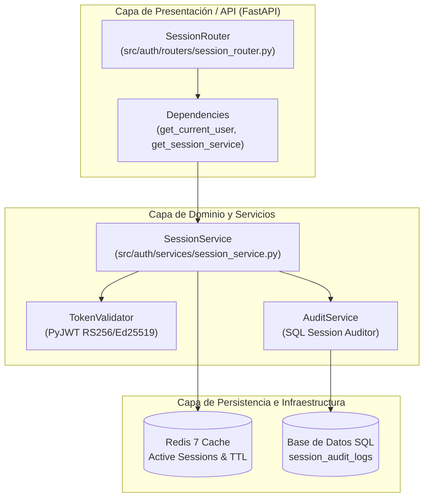
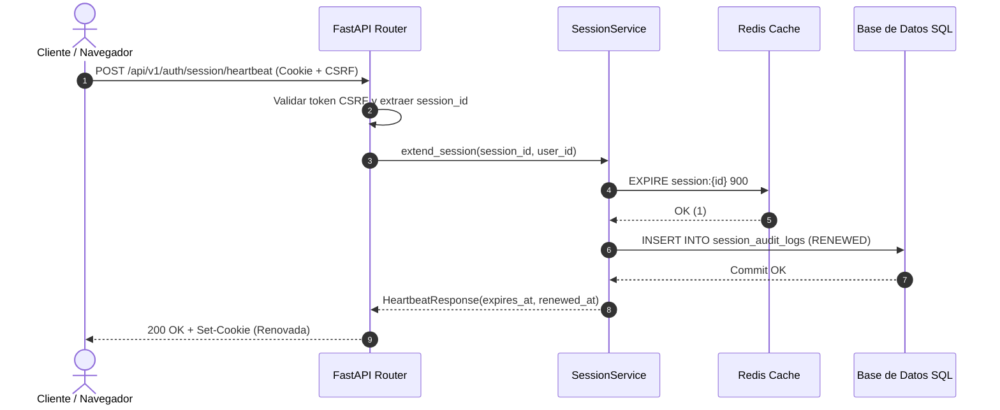

# Documento de Diseño Técnico: US10293 — Renovación de Sesión por Heartbeat (Python)

> **Identificador Rally:** `US10293`  
> **Basado en:** `.docs/requerimientos_python.md` (US10293)  
> **Stack Detectado:** `python (Python 3.12, FastAPI 0.111, Pydantic v2, SQLAlchemy 2.0 / SQL, Redis 7, pytest)`  
> **Fecha de Generación:** 2026-10-24  
> **Arquitecto / Agente:** Copilot SDLC Automation Agent  

---

## 1. Diagrama de Arquitectura de Componentes



---

## 2. Inventario de Archivos Impactados

| Ruta de Archivo | Tipo de Acción | Justificación Técnica (Vínculo EARS) |
| :--- | :--- | :--- |
| `src/auth/schemas/session_schema.py` | **Nuevo** | Modelos Pydantic v2 para validación estricta de payloads (REQ-UBI-01). |
| `src/auth/models/session_audit.py` | **Nuevo** | Modelo declarativo SQLAlchemy para tabla SQL `session_audit_logs` (REQ-EVT-02, REQ-UBI-02). |
| `src/auth/services/session_service.py` | **Nuevo** | Lógica de negocio para rotación de TTL en Redis y registro SQL (REQ-EVT-01, REQ-STA-02). |
| `src/auth/routers/session_router.py` | **Modificar** | Exposición de endpoints `POST /session/heartbeat` y `POST /session/revoke` (REQ-EVT-01, REQ-NEG-01). |
| `tests/unit/test_session_service.py` | **Nuevo** | Tests unitarios con mocks de Redis y SQLAlchemy usando pytest (REQ-EVT-01, REQ-NEG-01). |
| `tests/integration/test_session_router.py` | **Nuevo** | Tests de integración API con `httpx.AsyncClient` y base de datos SQL de prueba (REQ-EVT-01, REQ-EVT-02). |

---

## 3. Especificación de Nuevos Módulos y Componentes

### 3.1 `src/auth/schemas/session_schema.py`
- **Responsabilidad:** Validar y serializar las peticiones y respuestas HTTP.
- **Modelos Pydantic:**
  ```python
  from pydantic import BaseModel, Field
  from datetime import datetime

  class HeartbeatResponse(BaseModel):
      success: bool = True
      session_expires_at: datetime
      renewed_at: datetime

  class RevokeSessionRequest(BaseModel):
      reason: str = Field(..., max_length=50)
  ```

### 3.2 `src/auth/services/session_service.py`
- **Responsabilidad:** Orquestar la rotación atómica de sesión en Redis y la inserción transaccional en SQL.
- **Firma del Servicio:**
  ```python
  class SessionService:
      def __init__(self, redis_client: Redis, db_session: AsyncSession):
          self.redis = redis_client
          self.db = db_session

      async def extend_session(self, session_id: str, user_id: str) -> HeartbeatResponse:
          """
          Renueva el TTL en Redis (900s) e inserta registro en la tabla SQL session_audit_logs.
          # Rally: US10293 — Requisito EARS: REQ-EVT-01
          """
          ...

      async def revoke_session(self, session_id: str, user_id: str, reason: str) -> None:
          """
          Elimina la sesión de Redis e invalida el token.
          # Rally: US10293 — Requisito EARS: REQ-EVT-02
          """
          ...
  ```

---

## 4. Modelo de Datos y Esquema SQL

```sql
-- DDL para PostgreSQL / SQLite:
CREATE TABLE IF NOT EXISTS session_audit_logs (
    id VARCHAR(36) PRIMARY KEY,
    user_id VARCHAR(50) NOT NULL,
    session_id VARCHAR(64) NOT NULL,
    event_type VARCHAR(30) NOT NULL, -- RENEWED, REVOKED_TIMEOUT, REVOKED_MANUAL
    ip_address VARCHAR(45),
    correlation_id VARCHAR(36) NOT NULL,
    created_at TIMESTAMP WITH TIME ZONE DEFAULT CURRENT_TIMESTAMP
);

CREATE INDEX IF NOT EXISTS idx_session_audit_user_id ON session_audit_logs(user_id);
CREATE INDEX IF NOT EXISTS idx_session_audit_created_at ON session_audit_logs(created_at);
```

---

## 5. Contratos de Interfaz (FastAPI)

### 5.1 Endpoint Heartbeat
```http
POST /api/v1/auth/session/heartbeat HTTP/1.1
Host: api.banking.internal
Cookie: session_token=s_49f82b1...
X-CSRF-Token: a92f4c...

HTTP/1.1 200 OK
Content-Type: application/json
Set-Cookie: session_token=s_91a0c2...; HttpOnly; Secure; SameSite=Strict; Max-Age=900; Path=/

{
  "success": true,
  "session_expires_at": "2026-10-24T20:25:00Z",
  "renewed_at": "2026-10-24T20:10:00Z"
}
```

### 5.2 Endpoint Revocación
```http
POST /api/v1/auth/session/revoke HTTP/1.1
Host: api.banking.internal
Content-Type: application/json

{
  "reason": "inactivity_timeout"
}

HTTP/1.1 200 OK
{
  "success": true,
  "message": "Session successfully terminated"
}
```

---

## 6. Registro de Decisiones de Arquitectura (ADR)

| Decisión | Opciones Consideradas | Opción Elegida | Justificación Técnica |
| :--- | :--- | :--- | :--- |
| **Almacenamiento de Sesiones Activas** | A) Tabla SQL transaccional<br>B) Redis con TTL + SQL para auditoría | **Opción B** | Redis ofrece latencias < 2 ms para chequeo en cada request; SQL asegura trazabilidad inmutable y consultas de auditoría. |
| **Framework Web** | A) Flask / WSGI sincrónico<br>B) FastAPI / ASGI asincrónico | **Opción B** | I/O asíncrono no bloqueante para alta concurrencia de heartbeats concurrentes (asyncpg + redis.asyncio). |

---

## 7. Estrategia de Testing (pytest)

| Nivel de Test | Archivo | Criterio EARS Validado |
| :--- | :--- | :--- |
| **Unitaria** | `tests/unit/test_session_service.py` | `REQ-EVT-01`: Renovación atómica de TTL en Redis (900s) y llamada a auditoría SQL. |
| **Unitaria Negativa** | `tests/unit/test_session_service.py` | `REQ-NEG-01`: Lanzamiento de `SessionExpiredException` si la clave no existe en Redis. |
| **Integración API** | `tests/integration/test_session_router.py` | `REQ-EVT-01`: Invocación HTTP con `httpx.AsyncClient` verificando cookie Set-Cookie y JSON 200. |
| **Integración API** | `tests/integration/test_session_router.py` | `REQ-EVT-02`: Invocación de revocación comprobando eliminación de clave en Redis e inserción en SQL. |

---

## 8. Consideraciones de Seguridad (OWASP Top 10)

- **A02:2021 — Cryptographic Failures:** Cookies marcadas como `HttpOnly; Secure; SameSite=Strict`. Tokens firmados criptográficamente.
- **A03:2021 — SQL Injection:** Todo acceso SQL se realiza mediante queries parametrizadas con SQLAlchemy Core / ORM. Ningún string concatenado.
- **A07:2021 — Identification and Authentication Failures:** Invalidez inmediata en Redis y rotación de identificadores de sesión en cada heartbeat para prevenir fixation attacks.

---

## 9. Diagrama de Secuencia del Flujo de Heartbeat


