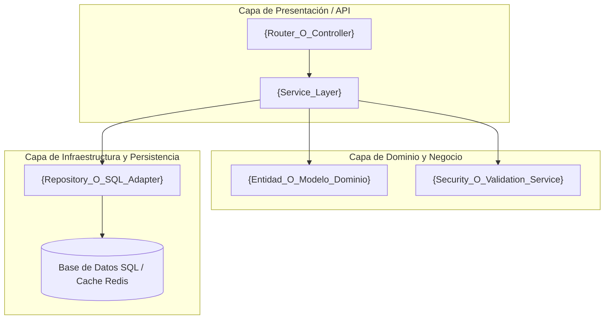
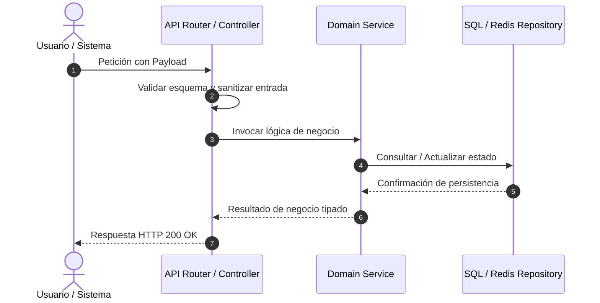

# Documento de Diseño Técnico: {RALLY_FORMATTED_ID} — {TITLE}

> **Identificador Rally:** `{RALLY_FORMATTED_ID}`  
> **Basado en:** `.docs/requerimientos.md`  
> **Stack Detectado:** `{DETECTED_STACK}` (Python o Java)  
> **Fecha de Generación:** {DATE}  
> **Arquitecto / Agente:** Copilot SDLC Automation Agent  

---

## 1. Diagrama de Arquitectura de Componentes



---

## 2. Inventario de Archivos Impactados

| Ruta de Archivo | Tipo de Acción | Justificación Técnica (Vínculo EARS) |
| :--- | :--- | :--- |
| `{src/path/to/existing_file.py|.java}` | Modificar | {Motivo del cambio referenciando REQ-EVT-01} |
| `{src/path/to/new_module.py|.java}` | Crear | {Responsabilidad modular según REQ-STA-01} |
| `{tests/path/to/test_file.py|.java}` | Crear / Modificar | {Estrategia de verificación unitaria REQ-NEG-01} |

---

## 3. Especificación de Nuevos Módulos y Componentes

### 3.1 Módulo: `{NOMBRE_COMPONENTE_O_ARCHIVO}`
- **Ruta:** `{path/to/component}`
- **Responsabilidad Principal:** {Explicación de qué hace este módulo y por qué cumple el principio de responsabilidad única SRP}.
- **Interfaces / Protocolos Expuestos:**
  - En Python: `async def execute_action(param: Type) -> ReturnType:`
  - En Java: `public ReturnType executeAction(ParamType param) throws BusinessException;`
- **Dependencias Directas:** `{listado de librerías o módulos internos}`

---

## 4. Modelo de Datos y Esquemas SQL

```sql
-- Definición de esquema SQL (si aplica)
CREATE TABLE IF NOT EXISTS {table_name} (
    id VARCHAR(36) PRIMARY KEY,
    user_id VARCHAR(50) NOT NULL,
    status VARCHAR(20) NOT NULL,
    created_at TIMESTAMP WITH TIME ZONE DEFAULT CURRENT_TIMESTAMP,
    updated_at TIMESTAMP WITH TIME ZONE DEFAULT CURRENT_TIMESTAMP
);
```

### Esquema de Transferencia de Datos (DTO / Serializer)
```json
{
  "$schema": "http://json-schema.org/draft-07/schema#",
  "title": "{NombreEntidad}",
  "type": "object",
  "properties": {
    "id": { "type": "string", "format": "uuid" },
    "createdAt": { "type": "string", "format": "date-time" },
    "status": { "type": "string", "enum": ["ACTIVE", "EXPIRED", "REVOKED"] }
  },
  "required": ["id", "createdAt", "status"]
}
```

---

## 5. Contratos de Interfaz y Firmas de Métodos

### Endpoint / API Signature (si aplica):
```http
POST /api/v1/{recurso}
Authorization: Bearer <token>
Content-Type: application/json

Payload:
{
  "field": "value"
}

Response (200 OK):
{
  "success": true,
  "data": { ... }
}
```

### Firma de Función / Servicio:

#### En Python:
```python
async def handle_operation(input_data: OperationInput) -> OperationResult:
    """
    Procesa la operación solicitada conforme al requisito REQ-EVT-01.
    :param input_data: Parámetros sanitizados validados con Pydantic.
    :return: Resultado tipado de la operación.
    :raises BusinessValidationError: si los parámetros no satisfacen la regla EARS REQ-NEG-01.
    """
    ...
```

#### En Java:
```java
/**
 * Procesa la operación solicitada conforme al requisito REQ-EVT-01.
 * @param input Parámetros validados con Bean Validation.
 * @return Resultado tipado de la operación.
 * @throws BusinessValidationException si no se satisface la regla EARS REQ-NEG-01.
 */
public OperationResult handleOperation(OperationInput input) throws BusinessValidationException {
    // Implementación
}
```

---

## 6. Registro de Decisiones de Arquitectura (ADR)

| Decisión | Opciones Consideradas | Opción Elegida | Justificación Técnica |
| :--- | :--- | :--- | :--- |
| **Persistencia / Estado** | A) Memoria volátil<br>B) Redis distribuido + SQL | **Opción B** | Escalabilidad horizontal y persistencia auditable entre reinicios. |
| **Estrategia de Reintentos** | A) Reintento inmediato<br>B) Exponential backoff con jitter | **Opción B** | Previene sobrecarga por estampida (thundering herd) ante fallos temporales. |

---

## 7. Estrategia de Testing y Cobertura

| Tipo de Prueba | Fichero de Test | Escenario / Criterio EARS Validado |
| :--- | :--- | :--- |
| **Unitaria** | `tests/unit/{test_name}` | `REQ-EVT-01`: Validación de ejecución nominal (Happy Path). |
| **Unitaria Negativa** | `tests/unit/{test_name}` | `REQ-NEG-01`: Lanzamiento y captura de excepción ante payload malformado. |
| **Integración** | `tests/integration/{test_name}` | `REQ-STA-01`: Persistencia en repositorio SQL/Redis y retorno de estado. |

---

## 8. Consideraciones de Seguridad y Mitigación de Riesgos

- **Validación de Entradas:** Validación estricta con Pydantic (Python) o Bean Validation (Java) en la frontera (evita OWASP A03).
- **Consultas Seguras:** Consultas SQL parametrizadas a través de ORM (SQLAlchemy / JPA) para prevenir inyecciones SQL.
- **Control de Acceso:** Verificación explícita de privilegios antes de ejecutar la mutación de estado (OWASP A01).
- **Sanitización de Salidas:** Eliminación de datos sensibles antes de emitir respuestas HTTP o escribir logs (OWASP A02/A09).

---

## 9. Diagrama de Secuencia del Flujo Principal


