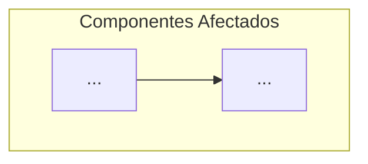
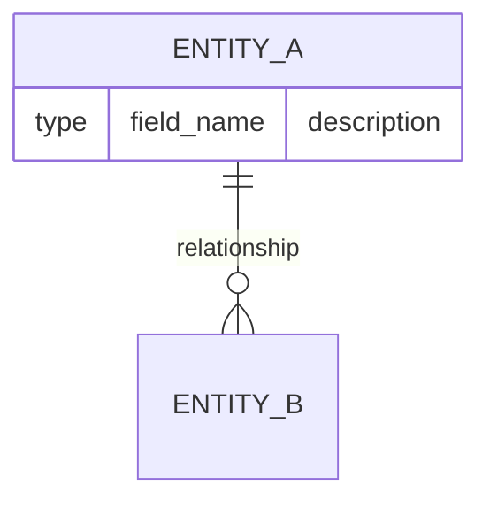
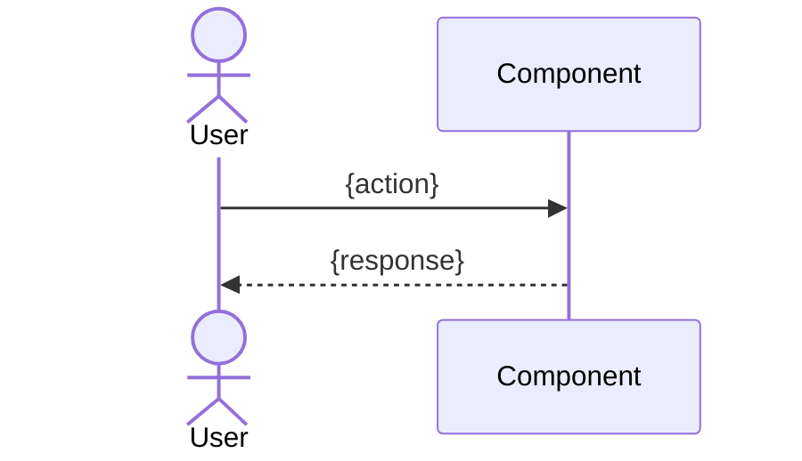

# Diseño Técnico: {RALLY_FORMATTED_ID} — {TITLE}

> **Rally ID:** {FormattedID}
> **Basado en:** `.docs/requerimientos.md`
> **Stack detectado:** {DETECTED_STACK}
> **Fecha de generación:** {DATE}

---

## Diagrama de Arquitectura



## Archivos a Modificar

| Archivo | Tipo de Cambio | Justificación |
|:---|:---|:---|
| `{path}` | Modificar | {reason linked to requirement} |
| `{path}` | Nuevo | {reason} |

## Archivos Nuevos a Crear

### `{path/to/new/file}`
- **Responsabilidad:** {what this file does}
- **Interfaces:** {what it exposes/consumes}
- **Dependencias:** {what it requires}

## Modelo de Datos

{Only if applicable — new entities, schema changes, migrations}



## Contratos de Interfaz

{New or modified APIs, function signatures, event contracts}

```
// Ejemplo de contrato
function functionName(param1: Type, param2: Type): ReturnType
  - Precondiciones: {preconditions}
  - Postcondiciones: {postconditions}
  - Errores: {possible errors}
```

## Decisiones de Diseño

| Decisión | Alternativas | Justificación |
|:---|:---|:---|
| {choice} | {alternatives} | {why this was chosen} |

## Estrategia de Testing

| Tipo de Test | Archivo | Cobertura |
|:---|:---|:---|
| Unitario | `{test_path}` | {what it validates} |
| Integración | `{test_path}` | {what flow it covers} |
| Edge Case | `{test_path}` | {boundary conditions tested} |

## Consideraciones de Seguridad

- {Input validation requirements}
- {Authentication/authorization needs}
- {Data protection measures}
- {Logging and audit trail}

## Diagrama de Secuencia (Flujo Principal)



## Plan de Implementación

| Orden | Tarea | Archivo(s) | Estimación |
|:------|:------|:-----------|:-----------|
| 1 | {task description} | `{file}` | {estimate} |
| 2 | {task description} | `{file}` | {estimate} |

## Riesgos Técnicos

| Riesgo | Probabilidad | Impacto | Mitigación |
|:-------|:-------------|:--------|:-----------|
| {risk} | Alta/Media/Baja | Alto/Medio/Bajo | {mitigation strategy} |
