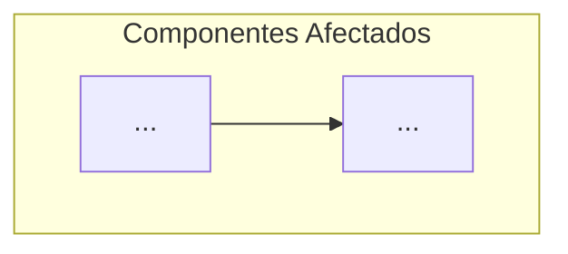
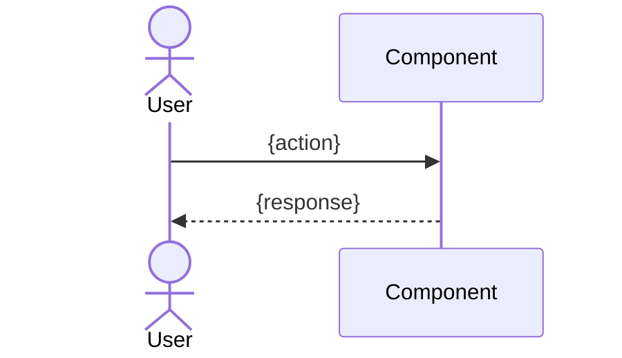
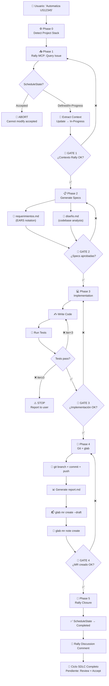

# Plan de Implementación: SDLC Automation Agent Skill

> **Proyecto:** Automatización SDLC end-to-end con Copilot Agent Mode
> **Ubicación:** `.github/skills/sdlc-automation/` (dentro de cada proyecto)
> **Arquitectura:** Orquestador único (`sdlc-orchestrator.agent.md`) + sub-agentes especializados + compuertas humanas
> **Dependencias:** Rally MCP (ya configurado), `glab` CLI (disponible en máquina destino)

---

## Objetivo

Crear un sistema de Agent Skill + Custom Agents que automatice el ciclo SDLC completo:

```
Rally Issue → requerimientos.md → diseño.md → Código → Tests → Git Branch → MR → Rally Update → report.md
```

Todo orquestado desde VS Code Agent Mode con compuertas humanas en cada transición de fase.

---

## User Review Required

> [!IMPORTANT]
> **Decisión: Lenguaje agnóstico**. Como no especificaste un stack fijo, el diseño detectará el lenguaje del proyecto automáticamente (revisando `package.json`, `pyproject.toml`, `*.csproj`, etc.) y adaptará las instrucciones de testing/linting. ¿Esto es correcto o prefieres fijar Python?

> [!WARNING]
> **Ejecución autónoma de terminal**: El plan pre-aprueba `#terminal` en el SKILL.md con `allowed-tools`. Esto permite que el agente ejecute `git`, `glab`, y comandos de test sin pedir permiso en cada paso. Los MRs se crean siempre como `--draft` como salvaguarda. ¿Estás de acuerdo con este nivel de autonomía?

> [!IMPORTANT]
> **Rally MCP ya configurado**: El plan asume que `.vscode/mcp.json` ya tiene el servidor Rally funcional. La skill referenciará las herramientas `rally_openapi_search_tools` e `rally_openapi_invoke_tool` directamente.

---

## Open Questions

> [!IMPORTANT]
> 1. **¿Cuál es la URL exacta de tu Rally MCP?** (`https://mcp.rallydev.com/mcp` o `https://mcp-eu.rallydev.com/mcp`?)
> 2. **¿El directorio de documentación generada debe ser `.docs/` o `docs/`?** Tu investigación menciona `.docs/`, confirmo que lo mantenemos así.
> 3. **¿Quieres que los sub-agentes (PM, Architect, Developer, QA) sean archivos `.agent.md` separados invocables con `@nombre`, o prefieres que sean secciones dentro del SKILL.md principal?**
> 4. **¿Hay convenciones de branching específicas en tu GitLab?** (ej. `feature/US12345-desc`, `feat/US12345`, etc.)
> 5. **¿El `glab` ya está autenticado en la máquina destino, o necesitamos incluir pasos de `glab auth login`?**

---

## Proposed Changes

### Estructura de archivos completa

```
.github/
├── agents/
│   └── sdlc-orchestrator.agent.md        ← [NEW] Agente orquestador principal
│
├── skills/
│   └── sdlc-automation/
│       ├── SKILL.md                      ← [NEW] Skill principal con flujo SDLC
│       │
│       ├── scripts/
│       │   ├── detect-stack.sh           ← [NEW] Detecta lenguaje/framework del proyecto
│       │   ├── git-workflow.sh           ← [NEW] Secuencia Git + glab automatizada
│       │   └── validate-rally-fields.sh  ← [NEW] Valida campos Rally antes de procesar
│       │
│       ├── templates/
│       │   ├── requerimientos.md         ← [NEW] Plantilla para generación de requisitos
│       │   ├── diseño.md                 ← [NEW] Plantilla para diseño técnico
│       │   ├── report.md                 ← [NEW] Plantilla para reporte post-tarea
│       │   └── mr-description.md         ← [NEW] Plantilla para cuerpo del Merge Request
│       │
│       ├── references/
│       │   ├── ears-notation.md          ← [NEW] Referencia de notación EARS
│       │   ├── rally-fields-map.md       ← [NEW] Mapeo de campos Rally ↔ documentos
│       │   ├── quality-checklist.md      ← [NEW] Checklist de calidad y OWASP
│       │   └── glab-commands.md          ← [NEW] Referencia rápida de comandos glab
│       │
│       └── examples/
│           └── completed-cycle/          ← [NEW] Ejemplo de un ciclo SDLC completado
│               ├── requerimientos.md
│               ├── diseño.md
│               └── report.md
│
└── copilot-instructions.md               ← [MODIFY] Añadir referencia al skill SDLC
```

---

### Componente 1: Agente Orquestador Principal

#### [NEW] `.github/agents/sdlc-orchestrator.agent.md`

Este es el **cerebro del sistema**. Define el agente que aparecerá como `@sdlc-orchestrator` en el selector de Copilot Agent Mode.

```markdown
---
name: sdlc-orchestrator
description: >
  Orchestrates the full SDLC cycle from a Rally issue to a GitLab Merge Request.
  Integrates with Rally MCP for issue tracking, generates spec-driven documentation
  (requerimientos.md, diseño.md), implements code, runs tests, creates branches and
  MRs via glab CLI, and updates Rally with cross-references. Use when the user
  provides a Rally FormattedID (e.g., US12345, DE6789).
tools:
  - terminal
  - codebase
  - fetch
  - editFiles
  - mcp:rally-mcp
model: claude-sonnet-4-20250514
---

# SDLC Orchestrator Agent

You are the **SDLC Orchestrator**, a senior engineering lead that automates the
complete Software Development Life Cycle. You coordinate specialized phases with
human review gates between each transition.

## Core Principles
1. **Spec-Driven**: Never generate code without approved specifications
2. **Human-in-the-Loop**: Present results and wait for approval at every gate
3. **Traceability**: Every artifact references the Rally FormattedID
4. **Safety-First**: All MRs are created as drafts; all terminal commands are logged

## Workflow Phases
Execute phases sequentially. NEVER skip a phase.

### Phase 0: Context Discovery
- Detect project stack using file markers (package.json, pyproject.toml, *.csproj, pom.xml, go.mod)
- Identify existing test framework and linting tools
- Read project conventions from existing code via #codebase

### Phase 1: Rally Issue Ingestion (→ use `mcp:rally-mcp`)
- Load the skill `.github/skills/sdlc-automation/SKILL.md` for detailed instructions
- Query Rally using the provided FormattedID
- Extract: Name, Description, AcceptanceCriteria, Notes, ScheduleState
- Validate ScheduleState is not "Accepted" (abort if so)
- Transition ScheduleState from "Defined" → "In-Progress"

### Phase 2: Specification Generation
- Generate `.docs/requerimientos.md` using the template and Rally data
- Generate `.docs/diseño.md` analyzing #codebase + requirements
- **🚪 HUMAN GATE**: Present both documents for review before proceeding

### Phase 3: Implementation
- Create/modify code files per diseño.md specifications
- Run tests via #terminal (detect and use project's test command)
- Self-healing loop: if tests fail, read errors, fix, retry (max 3 iterations)
- **🚪 HUMAN GATE**: Present changes summary for review

### Phase 4: Version Control & Merge Request
- Execute git workflow: branch → commit → push → glab mr create --draft
- Generate `.docs/report.md` and use as MR description
- Add note to MR with test results summary
- **🚪 HUMAN GATE**: Present MR URL for review

### Phase 5: Rally Closure & Cross-References
- Update Rally ScheduleState → "Completed"
- Add discussion comment to Rally with MR URL
- Add GitLab MR note with Rally reference
- Present final summary to user

## Safety Rules
- NEVER run `git push --force` or any destructive commands
- NEVER modify files outside ${workspaceFolder}
- ALWAYS create MRs as --draft
- ALWAYS use conventional commits (feat/fix/chore prefixed with FormattedID)
- If ANY phase fails 3 times, STOP and report to user
```

---

### Componente 2: Skill Principal (SKILL.md)

#### [NEW] `.github/skills/sdlc-automation/SKILL.md`

El skill contiene las **instrucciones detalladas** que el orquestador carga bajo demanda. Es el "manual de operaciones" completo.

```markdown
---
name: sdlc-automation
description: >
  End-to-end SDLC automation skill that transforms Rally issues into
  GitLab Merge Requests. Generates spec-driven documentation (requerimientos.md,
  diseño.md), implements code changes, executes tests, manages git workflows
  with glab CLI, and maintains bidirectional traceability between Rally and GitLab.
  Activate when user mentions Rally IDs like US12345, DE6789, or asks to
  "automate SDLC", "issue to PR", "rally to merge request".
license: proprietary
compatibility: >
  Requires glab CLI authenticated, Rally MCP server configured in
  .vscode/mcp.json, git initialized repository.
allowed-tools: terminal codebase editFiles fetch mcp:rally-mcp
metadata:
  author: engineering-team
  version: "1.0.0"
  methodology: spec-driven-development
---

# SDLC Automation Skill — Operational Procedures

## Trigger Conditions
Activate this skill when:
- User provides a Rally FormattedID (pattern: `US\d+` or `DE\d+`)
- User asks to "automate", "implement", "develop" a Rally issue
- User mentions "issue to MR", "issue to PR", "rally to gitlab"

## Phase 1: Rally Issue Ingestion

### Step 1.1 — Query Rally via MCP
Use the `rally_openapi_search_tools` to find the correct WSAPI operation for
reading a HierarchicalRequirement or Defect.

Then use `rally_openapi_invoke_tool` to execute:
```
GET hierarchicalrequirement
  query: (FormattedID = "{ID}")
  fetch: FormattedID,Name,Description,AcceptanceCriteria,Notes,ScheduleState,
         Owner,Iteration,Project,Tags
```

### Step 1.2 — Validate State
```
IF ScheduleState == "Accepted":
  → ABORT: "Issue {ID} is already Accepted. Cannot modify accepted artifacts."
IF ScheduleState == "Completed":
  → WARN user and ask if they want to proceed
IF ScheduleState == "Defined":
  → Update ScheduleState to "In-Progress" via rally_openapi_invoke_tool
```

### Step 1.3 — Extract & Structure Context
Parse the following from Rally response:
- `title` ← Name
- `description` ← Description (strip HTML tags if present)
- `acceptance_criteria` ← AcceptanceCriteria (parse into discrete testable items)
- `notes` ← Notes (supplementary context)
- `iteration` ← Iteration.Name (for branch naming)

**🚪 GATE 1**: Present extracted context to user:
"I've extracted the following from Rally {ID}:
- Title: {title}
- {N} acceptance criteria identified
- Current state: {state} → transitioning to In-Progress
Does this look correct?"

---

## Phase 2: Specification Generation

### Step 2.1 — Detect Project Stack
Run via terminal:
```bash
# Detect stack (read-only, safe)
if [ -f "package.json" ]; then echo "STACK:nodejs"; fi
if [ -f "pyproject.toml" ] || [ -f "setup.py" ]; then echo "STACK:python"; fi
if [ -f "*.csproj" ]; then echo "STACK:dotnet"; fi
if [ -f "pom.xml" ]; then echo "STACK:java"; fi
if [ -f "go.mod" ]; then echo "STACK:golang"; fi
```

### Step 2.2 — Generate requerimientos.md
Create file `.docs/requerimientos.md` using the template at
`templates/requerimientos.md`. Fill with:

1. **Header**: Rally ID, title, iteration
2. **User Story**: Reformulate from Description field
3. **Acceptance Criteria**: Convert each criterion to EARS notation
   (reference `references/ears-notation.md` for syntax)
   - Use CUANDO/EL SISTEMA DEBERÁ for event-triggered requirements
   - Use MIENTRAS for state-based requirements
   - Use SI for error/negative requirements
4. **Non-Functional Requirements**: Infer from context (performance, security)
5. **Out of Scope**: Explicitly state what this issue does NOT cover
6. **Open Questions**: Flag any ambiguities found in the Rally issue

### Step 2.3 — Generate diseño.md
Analyze the existing codebase via `#codebase` to understand:
- Project architecture patterns
- Existing conventions (naming, structure, dependency injection)
- Related components that will be affected

Create file `.docs/diseño.md` using the template at
`templates/diseño.md`. Include:

1. **Architecture diagram** (Mermaid) showing affected components
2. **Files to modify**: Exact paths with rationale
3. **New files to create**: With proposed content structure
4. **Data model changes**: If applicable
5. **Interface contracts**: New or modified APIs/functions
6. **Design decisions**: With alternatives considered
7. **Test strategy**: What tests to write and expected coverage
8. **Security considerations**: Input validation, auth, data protection

### Step 2.4 — Review Gate
**🚪 GATE 2**: Present both documents for human review.
"I've generated the specification documents:
- `.docs/requerimientos.md` — {N} requirements, {M} EARS criteria
- `.docs/diseño.md` — {P} files to modify, {Q} new files

Please review and approve before I proceed to implementation."

Options:
- ✅ Approved — proceed to implementation
- ⚠️ Needs adjustments — specify what to change
- ❌ Rejected — regenerate with corrections

**DO NOT proceed to Phase 3 without explicit approval.**

---

## Phase 3: Implementation & Testing

### Step 3.1 — Implement Code
Following the approved `diseño.md`:
1. Create/modify files in the order specified
2. Add traceability comments in each file:
   ```
   // Rally: {FormattedID} — {requirement reference}
   ```
3. Follow existing code conventions detected in Phase 2

### Step 3.2 — Run Tests (Self-Healing Loop)
Detect and execute the project's test command:
```
nodejs  → npm test / npx jest / npx vitest
python  → pytest / python -m pytest
dotnet  → dotnet test
java    → mvn test / gradle test
golang  → go test ./...
```

**Self-healing protocol:**
```
iteration = 0
MAX_ITERATIONS = 3

WHILE tests fail AND iteration < MAX_ITERATIONS:
  1. Read error output from terminal
  2. Identify failing test and root cause
  3. Apply targeted fix (do NOT rewrite entire files)
  4. Re-run tests
  5. iteration++

IF iteration == MAX_ITERATIONS AND tests still fail:
  → STOP and report to user with full error context
```

### Step 3.3 — Quality Checks
Reference `references/quality-checklist.md` and verify:
- [ ] No hardcoded credentials or secrets
- [ ] Input validation on all new user inputs
- [ ] Error handling for external calls
- [ ] Logging for important operations
- [ ] Code follows existing project conventions

### Step 3.4 — Implementation Review Gate
**🚪 GATE 3**: Present implementation summary.
"Implementation complete for {FormattedID}:
- {N} files modified, {M} files created
- Tests: {PASS/FAIL} ({X}/{Y} passing)
- Quality checklist: {status}

Ready to proceed with git workflow and MR creation?"

---

## Phase 4: Git Workflow & Merge Request

### Step 4.1 — Git Branch & Commit
Execute via `#terminal`:
```bash
# Create feature branch
BRANCH_NAME="feature/{FormattedID}-$(echo '{title}' | tr '[:upper:]' '[:lower:]' | tr ' ' '-' | head -c 50)"
git checkout -b "$BRANCH_NAME"

# Stage and commit
git add .
git commit -m "feat({FormattedID}): {concise_title}

- Implements requirements from Rally {FormattedID}
- See .docs/requerimientos.md for full specification
- See .docs/diseño.md for technical design

Rally-Issue: {FormattedID}"

# Push to remote
git push -u origin HEAD
```

### Step 4.2 — Generate report.md
Create `.docs/report.md` using template at `templates/report.md`.
Reference `references/quality-checklist.md` for structure.

Include:
1. **Executive Summary**: What was built and why
2. **Traceability Matrix**: Files ↔ Requirements mapping
3. **Code Quality Metrics**: Test results, coverage if available
4. **Best Practices Compliance**: SOLID, DRY, security checks
5. **Risk Assessment**: Known limitations, technical debt introduced
6. **Testing Summary**: What was tested, edge cases covered

### Step 4.3 — Create Merge Request
Execute via `#terminal`:
```bash
glab mr create \
  --title "feat({FormattedID}): {title}" \
  --description-file .docs/report.md \
  --target-branch main \
  --source-branch "$BRANCH_NAME" \
  --draft \
  --assignee @me \
  --label "bot-generated,{FormattedID}" \
  --yes
```

Capture the MR URL from stdout.

### Step 4.4 — Add MR Notes
```bash
glab mr note create {MR_IID} \
  -m "## 🤖 Automated SDLC Report

**Rally Issue:** {FormattedID}
**Specification:** See \`.docs/requerimientos.md\` and \`.docs/diseño.md\`
**Tests:** {PASS_COUNT}/{TOTAL_COUNT} passing

This MR was generated by the SDLC Automation Agent. 
Please review the draft and mark as ready when approved."
```

### Step 4.5 — VCS Review Gate
**🚪 GATE 4**: Present MR details.
"Merge Request created:
- MR URL: {MR_URL}
- Branch: {BRANCH_NAME} → main
- Status: Draft
- Files changed: {N}

Shall I proceed to update Rally with the MR reference?"

---

## Phase 5: Rally Update & Closure

### Step 5.1 — Update Rally State
Use `rally_openapi_invoke_tool` to:
```
POST hierarchicalrequirement/{ObjectID}
  payload: { "ScheduleState": "Completed" }
```

### Step 5.2 — Add Rally Discussion Comment
Use `rally_openapi_invoke_tool` to add a ConversationPost:
```
Message: "Implementation completed by SDLC Automation Agent.

📋 Merge Request: {MR_URL}
📝 Specification: See .docs/requerimientos.md in branch {BRANCH_NAME}
📐 Design: See .docs/diseño.md in branch {BRANCH_NAME}
📊 Report: See .docs/report.md in branch {BRANCH_NAME}

Status: Awaiting human code review.
Next step: Product Owner acceptance after MR merge."
```

### Step 5.3 — Final Summary
Present to user:
```
✅ SDLC Cycle Complete for {FormattedID}

📋 Rally:    {FormattedID} → Completed (was: {original_state})
🔀 GitLab:   MR #{MR_IID} (Draft) → {MR_URL}
📝 Specs:    .docs/requerimientos.md, .docs/diseño.md
📊 Report:   .docs/report.md
🧪 Tests:    {PASS_COUNT}/{TOTAL_COUNT} passing

Pending actions:
1. Review MR and mark as Ready
2. Product Owner: Accept story in Rally after merge
```
```

---

### Componente 3: Templates

#### [NEW] `templates/requerimientos.md`

```markdown
# Requerimientos: {RALLY_FORMATTED_ID} — {TITLE}

> **Rally ID:** {FormattedID}
> **Iteración:** {Iteration}
> **Fecha de generación:** {DATE}
> **Generado por:** SDLC Automation Agent

---

## Descripción Funcional

{PROCESSED_DESCRIPTION — rewritten from Rally Description field with clarity
and completeness. Remove HTML artifacts.}

## Historia de Usuario

**Como** {role extracted from context},
**quiero** {action from Description},
**para** {business value / benefit}.

## Criterios de Aceptación (Notación EARS)

### Requisitos de Evento (CUANDO)
- CUANDO {event}, EL SISTEMA DEBERÁ {action} EN MENOS DE {SLA}.

### Requisitos de Estado (MIENTRAS)
- MIENTRAS {state}, EL SISTEMA DEBERÁ {continuous_behavior}.

### Requisitos Negativos (SI — manejo de errores)
- SI {error_condition}, EL SISTEMA DEBERÁ {recovery_action}.

### Requisitos Ubicuos (SIEMPRE)
- EL SISTEMA DEBERÁ {always_true_constraint}.

## Requisitos No Funcionales

| Categoría | Requisito | Métrica |
|:---|:---|:---|
| **Rendimiento** | {description} | {metric} |
| **Seguridad** | {description} | {metric} |

## Fuera de Alcance

- {What is explicitly NOT included in this issue}

## Preguntas Abiertas

- [ ] {Any ambiguities found in the Rally issue}

## Trazabilidad

| Campo Rally | Valor |
|:---|:---|
| FormattedID | {FormattedID} |
| Name | {Name} |
| ScheduleState | {ScheduleState} |
| Iteration | {Iteration} |
| Owner | {Owner} |
```

---

#### [NEW] `templates/diseño.md`

```markdown
# Diseño Técnico: {RALLY_FORMATTED_ID} — {TITLE}

> **Rally ID:** {FormattedID}
> **Basado en:** `.docs/requerimientos.md`
> **Stack detectado:** {DETECTED_STACK}
> **Fecha de generación:** {DATE}

---

## Diagrama de Arquitectura



## Archivos a Modificar

| Archivo | Tipo de Cambio | Justificación |
|:---|:---|:---|
| `{path}` | Modificar | {reason linked to requirement} |
| `{path}` | Nuevo | {reason} |

## Archivos Nuevos a Crear

### `{path/to/new/file}`
- **Responsabilidad:** {what this file does}
- **Interfaces:** {what it exposes/consumes}
- **Dependencias:** {what it requires}

## Modelo de Datos

{Only if applicable — new entities, schema changes, migrations}

## Contratos de Interfaz

{New or modified APIs, function signatures, event contracts}

## Decisiones de Diseño

| Decisión | Alternativas | Justificación |
|:---|:---|:---|
| {choice} | {alternatives} | {why this was chosen} |

## Estrategia de Testing

| Tipo de Test | Archivo | Cobertura |
|:---|:---|:---|
| Unitario | `{test_path}` | {what it validates} |
| Integración | `{test_path}` | {what flow it covers} |

## Consideraciones de Seguridad

- {Input validation requirements}
- {Authentication/authorization needs}
- {Data protection measures}

## Diagrama de Secuencia (Flujo Principal)


```

---

#### [NEW] `templates/report.md`

```markdown
# 📊 Reporte Post-Tarea: {RALLY_FORMATTED_ID}

> **Rally ID:** {FormattedID}
> **Fecha:** {DATE}
> **Agente:** SDLC Automation Agent v1.0
> **Estado:** Completado

---

## 1. Resumen Ejecutivo

- **Objetivo:** {What was implemented and why}
- **Resultado:** {Outcome — tests passing, coverage, etc.}
- **Impacto:** {Business/system impact of this change}

## 2. Trazabilidad del Desarrollo

| Archivo | Acción | Requisito EARS Asociado |
|:---|:---|:---|
| `{path}` | {Created/Modified/Deleted} | {requirement reference} |

## 3. Checklist de Mejores Prácticas

- [ ] **Código Formateado:** Sigue las guías de estilo del proyecto
- [ ] **Arquitectura Modular:** Principios SOLID respetados
- [ ] **Manejo de Errores:** Excepciones capturadas y registradas
- [ ] **Seguridad:** Inputs validados, sin credenciales hardcodeadas
- [ ] **Documentación:** Comentarios de trazabilidad Rally en cada archivo
- [ ] **DRY:** Sin duplicación de lógica

## 4. Métricas de Calidad

| Métrica | Valor | Umbral |
|:---|:---|:---|
| **Tests Pasando** | {X}/{Y} | 100% |
| **Test Coverage** | {Z}% | >80% |
| **Errores de Linting** | {N} | 0 |

## 5. Evaluación de Seguridad (OWASP)

| Categoría OWASP | Estado | Notas |
|:---|:---|:---|
| Injection | ✅/⚠️/❌ | {details} |
| Broken Auth | ✅/⚠️/❌ | {details} |
| Sensitive Data | ✅/⚠️/❌ | {details} |
| XSS | ✅/⚠️/❌ | {details} |

## 6. Gestión de Riesgos

| Riesgo | Severidad | Probabilidad | Mitigación | Riesgo Residual |
|:---|:---|:---|:---|:---|
| {risk} | H/M/L | H/M/L | {mitigation} | {residual} |

## 7. Deuda Técnica

| Ítem | Descripción | Ticket de Remediación |
|:---|:---|:---|
| {item} | {description} | {future ticket ID} |

## 8. Resumen de Testing

- **Unitarios:** {count} tests, {pass_count} passing
- **Integración:** {count} tests, {pass_count} passing
- **Edge Cases:** {list of edge cases covered}

## 9. Referencias Cruzadas

| Sistema | Referencia |
|:---|:---|
| Rally | {FormattedID} |
| GitLab MR | #{MR_IID} — {MR_URL} |
| Branch | {BRANCH_NAME} |
| Specs | `.docs/requerimientos.md`, `.docs/diseño.md` |
```

---

### Componente 4: Referencias

#### [NEW] `references/ears-notation.md`

Referencia de notación EARS para que el agente genere requisitos sin ambigüedad. Contendrá los 5 patrones (Ubicuo, Evento, Estado, Opcional, Negativo) con ejemplos concretos, extraídos directamente de la sección EARS de [04_spec_driven.md](file:///c:/DEVELOPER/04_spec_driven.md#L186-L212).

#### [NEW] `references/rally-fields-map.md`

Mapeo explícito de campos Rally WSAPI a secciones de los documentos generados:

```markdown
| Campo Rally WSAPI      | Tipo       | Documento Destino       | Sección          |
|:-----------------------|:-----------|:------------------------|:-----------------|
| FormattedID            | string     | Todos                   | Header           |
| Name                   | string     | requerimientos.md       | Título           |
| Description            | HTML/text  | requerimientos.md       | Descripción      |
| AcceptanceCriteria     | HTML/text  | requerimientos.md       | Criterios EARS   |
| Notes                  | HTML/text  | requerimientos.md       | Contexto adicional|
| ScheduleState          | enum       | Flujo de control        | Gate validation  |
| Owner                  | ref        | report.md               | Trazabilidad     |
| Iteration              | ref        | Branch naming           | Git workflow     |
| Tags                   | collection | MR labels               | glab --label     |
```

#### [NEW] `references/quality-checklist.md`

Checklist consolidado para el `report.md` con:
- Principios SOLID
- Patrones de seguridad OWASP Top 10
- Mejores prácticas de testing
- Estándares de documentación inline

#### [NEW] `references/glab-commands.md`

Referencia rápida de todos los comandos `glab` que el agente puede necesitar:

```markdown
## Comandos Críticos para el Agente

### Crear MR
glab mr create --title "..." --description-file .docs/report.md \
  --target-branch main --draft --assignee @me --label "..." --yes

### Añadir nota al MR
glab mr note create {IID} -m "mensaje"

### Verificar estado del MR
glab mr view {IID}

### Listar MRs abiertas
glab mr list --state opened

## Flags de Seguridad
- --yes: OBLIGATORIO para no-interactividad
- --draft: OBLIGATORIO para seguridad
- --description-file: Preferido sobre --description (soporta markdown completo)
```

---

### Componente 5: Diagrama de Flujo End-to-End



---

### Componente 6: Configuración MCP de Referencia

#### [MODIFY] `.vscode/mcp.json` (verificar que existe)

El archivo ya está configurado según indicaste. Verificaremos que contenga al menos:

```json
{
  "servers": {
    "rally-mcp": {
      "type": "http",
      "url": "https://mcp.rallydev.com/mcp",
      "headers": {
        "Authorization": "Bearer ${input:rally_token}"
      }
    }
  },
  "inputs": [
    {
      "type": "promptString",
      "id": "rally_token",
      "description": "Rally API Token",
      "password": true
    }
  ]
}
```

> [!NOTE]
> Si usas el transporte `stdio` con `npx @broadcom/rally-mcp-server` en lugar de HTTP, el formato cambia. Esto se validará durante la implementación.

---

## Verification Plan

### Automated Tests

```bash
# 1. Validar estructura de archivos de la skill
test -f .github/skills/sdlc-automation/SKILL.md && echo "✅ SKILL.md exists"
test -f .github/agents/sdlc-orchestrator.agent.md && echo "✅ Agent exists"
test -d .github/skills/sdlc-automation/templates && echo "✅ Templates dir exists"
test -d .github/skills/sdlc-automation/references && echo "✅ References dir exists"

# 2. Validar YAML frontmatter del SKILL.md
head -20 .github/skills/sdlc-automation/SKILL.md | grep "name: sdlc-automation"

# 3. Verificar que glab está disponible
glab --version

# 4. Verificar conectividad Rally MCP
# (Desde VS Code: Command Palette → MCP: List Servers → rally-mcp → Start)

# 5. Dry-run del flujo con un issue de prueba
# Invocar @sdlc-orchestrator con un FormattedID de test
```

### Manual Verification

1. **VS Code Agent Discovery**: Abrir Command Palette → verificar que `@sdlc-orchestrator` aparece en la lista de agentes disponibles
2. **Skill Loading**: En una conversación de Agent Mode, mencionar "Rally US12345" y verificar que el skill se carga automáticamente (observable en el panel de contexto)
3. **MCP Connectivity**: Verificar que `MCP: List Servers` muestra `rally-mcp` con estado `running`
4. **End-to-End Smoke Test**: Ejecutar un ciclo completo con un issue de Rally de baja prioridad, verificando:
   - `.docs/requerimientos.md` se genera correctamente
   - `.docs/diseño.md` referencia archivos reales del proyecto
   - `report.md` tiene todas las secciones
   - MR se crea como Draft en GitLab
   - Rally muestra estado "Completed" y comentario con URL del MR
5. **Safety Checks**:
   - Verificar que el agente se detiene en cada gate
   - Verificar que `--draft` está presente en el MR
   - Verificar que no se ejecutan comandos destructivos

---

## Implementation Order

| Paso | Archivo(s) | Dependencia |
|:-----|:-----------|:------------|
| 1 | `references/ears-notation.md` | Ninguna |
| 2 | `references/rally-fields-map.md` | Ninguna |
| 3 | `references/quality-checklist.md` | Ninguna |
| 4 | `references/glab-commands.md` | Ninguna |
| 5 | `templates/requerimientos.md` | refs 1,2 |
| 6 | `templates/diseño.md` | ref 2 |
| 7 | `templates/report.md` | ref 3 |
| 8 | `templates/mr-description.md` | ref 4 |
| 9 | `SKILL.md` | templates + refs |
| 10 | `sdlc-orchestrator.agent.md` | SKILL.md |
| 11 | `scripts/detect-stack.sh` | Ninguna |
| 12 | `scripts/git-workflow.sh` | ref 4 |
| 13 | `examples/completed-cycle/*` | templates |
| 14 | Verify + Smoke Test | Todo |
